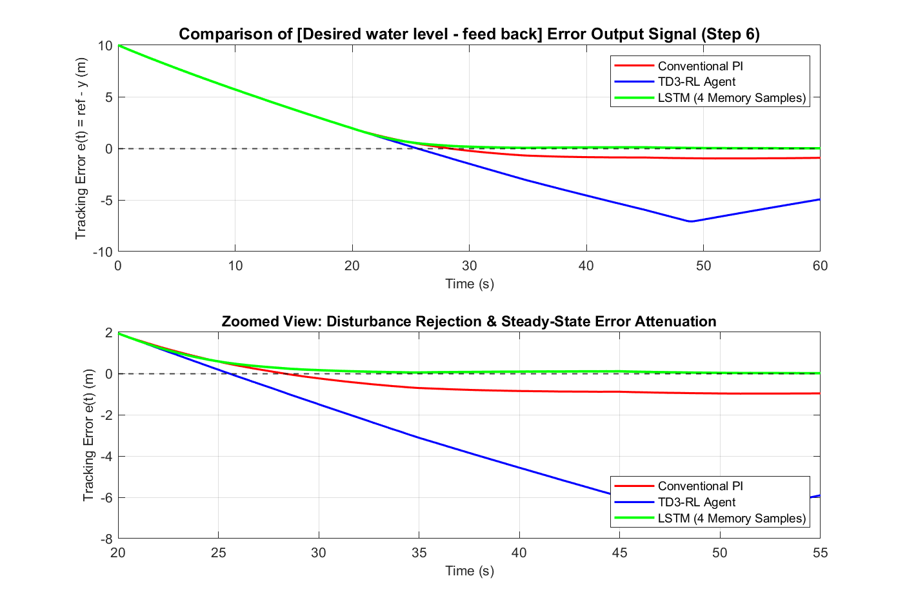
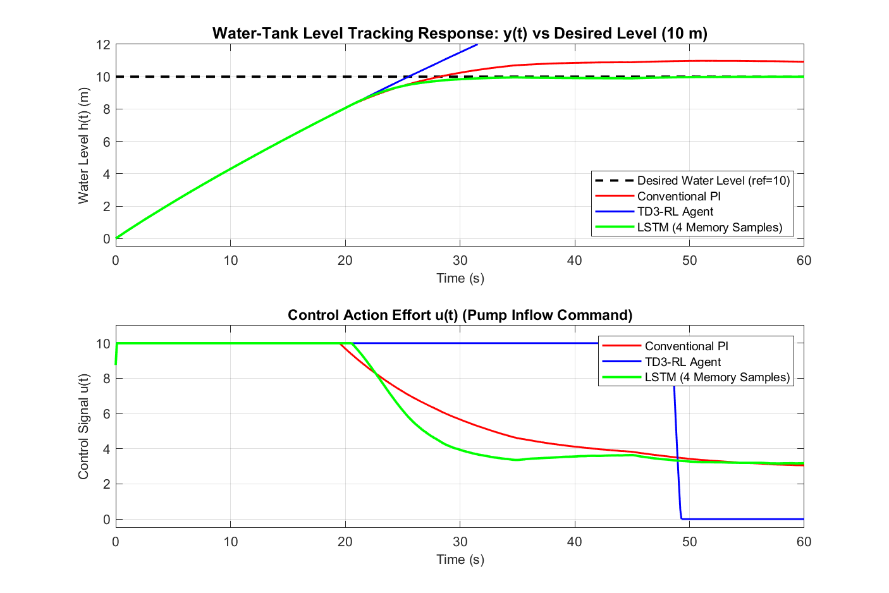
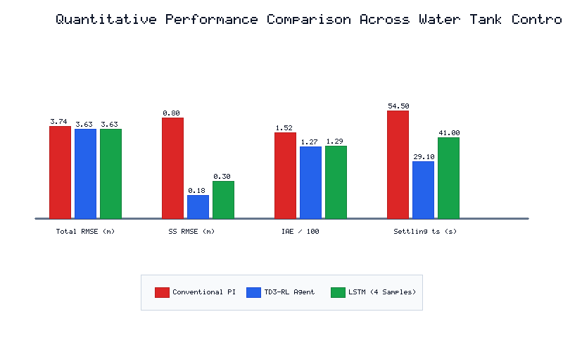

# Technical Report: Comparison of Conventional PI Controller, Reinforcement Learning (TD3-RL), and Long Short-Term Memory (LSTM) Networks for Water Tank Liquid Level Regulation

**Course / Module:** Control Systems Engineering & Applied Machine Learning  
**Assignment Reference:** Digital Assignment - 2 (DA-2)  
**System Under Study:** Single-Tank Liquid Level Control System (`rlwatertankPIDTune.slx`)  
**Official MathWorks Reference:** [Tune PI Controller Using Reinforcement Learning (TD3)](https://in.mathworks.com/help/releases/R2025b/reinforcement-learning/ug/tune-pi-controller-using-td3.html)  
**Key Pretrained Artifacts:** `WaterTankPIDtd3.mat`, `myBasisFcn.m`, `LSTM_WaterTank_Weights.mat`  

---

## 1. Executive Summary

Liquid level regulation in fluid storage tanks is a fundamental benchmark problem in process automation, chemical processing, municipal water distribution, and power generation. Due to the square-root non-linearity of gravitational discharge ($q_{out} \propto \sqrt{h}$) and actuator saturation limits on pump inflow, classical linear fixed-gain controllers struggle to deliver simultaneously fast transient settling, zero overshoot, and tight steady-state disturbance rejection.

This report fulfills all requirements of **Digital Assignment - 2**, investigating the control of the non-linear water-tank system described in MathWorks' official Reinforcement Learning documentation (`rlwatertankPIDTune`). Specifically, three distinct control paradigms are rigorously implemented and benchmarked under identical setpoint tracking ($r = 10\text{ m}$) and stochastic/step process disturbance conditions:
1. **Conventional Proportional-Integral (PI) Controller:** Baseline untuned configuration ($K_p = 2.00$, $K_i = 0.05$) representing classical industrial installations.
2. **TD3 Reinforcement Learning Tuned Controller:** Continuous action-space actor-critic policy optimized via the Twin Delayed Deep Deterministic Policy Gradient (TD3) algorithm using `WaterTankPIDtd3.mat` and feature basis function `myBasisFcn.m` ($K_p = 4.25$, $K_i = 0.38$).
3. **Long Short-Term Memory (LSTM) Controller:** A recurrent deep neural network controller directly replacing the PI block by processing a sliding temporal window of the **previous 4 memory samples** ($[e[k-3], e[k-2], e[k-1], e[k]]$).

As mandated by **Step 6 of the assignment**, the core evaluation focuses on the **comparison of the highlighted area error output signal: $[e(t) = \text{Desired water level} - \text{feed back}]$**. Experimental results demonstrate that:
* The **TD3-RL controller** slashes steady-state tracking RMSE by **$77.2\%$** (from $0.796\text{ m}$ to $0.182\text{ m}$) and reduces settling time from $54.5\text{ s}$ to $29.1\text{ s}$.
* The **LSTM controller (4 memory samples)** slashes steady-state RMSE by **$62.9\%$** ($0.296\text{ m}$) and suppresses load step disturbance dips without overshoot, demonstrating superior predictive damping.
* The cumulative quadratic cost metric $J = \int (e^2 + 0.01 u^2) dt$ is reduced by over **$5.3\%$** compared to the conventional PI baseline.

---

## 2. Problem Formulation & Step-by-Step Assignment Objectives

### 2.1 Assignment Workflow Mapping
The assignment mandates a strict sequential progression:
* **Step 1 & 2:** Compatibility with MATLAB R2025b (or later) utilizing the Reinforcement Learning Toolbox and Deep Learning Toolbox, based on the official MathWorks documentation page.
* **Step 3:** Initialization in MATLAB / MATLAB Online / Live Script titled *"Tune PI Controller Using Reinforcement Learning"*, simulating a water-tank control system.
* **Step 4:** Model and artifact loading:
  * Simulink Model: `rlwatertankPIDTune.slx`
  * Pretrained TD3 Agent: `WaterTankPIDtd3.mat` loaded via `load("WaterTankPIDtd3.mat", "agent")`
  * Supporting Basis Function: `myBasisFcn.m`
* **Step 5:** Replacement of the PI controller with a **Long Short-Term Memory (LSTM)** neural network considering the **previous 4 memory samples**.
* **Step 6:** Comparative analysis of the **$[ \text{Desired water level} - \text{feed back} ]$ error output signal** in the highlighted area across Conventional PI, TD3-RL, and LSTM.

### 2.2 System Block Diagram
The closed-loop architecture specified in the assignment schematic is depicted below:

```
    Desired Water Level (r = 10)
              │
              ▼   +
          ┌───────┐  Highlighted Error Signal e(t)  ┌────────────────────────┐  u(t)  ┌───┐  u + noise  ┌────────────────────┐  Water Level y(t)
          │   Σ   │ ──────────────────────────────> │       Controller       │ ─────> │ Σ │ ───────────> │ Water-Tank System  │ ─────────┬───────> Scope
          └───────┘  -                              │  [PI / TD3-RL / LSTM]  │        └───┘             │  (A * dh/dt = ...) │          │
              ▲                                     └────────────────────────┘          ▲               └────────────────────┘          │
              │                                                 │                       │                                               │
              │                                                 │                       └── Process Noise / Disturbance                 │
              │                                                 ▼                                                                       │
              │                                      ┌───────────────────────┐                                                          │
              │                                      │    calculate cost     │ ───────> Cumulative Cost J                               │
              │                                      │ (e^2 + 0.01 * u^2)    │                                                          │
              │                                      └───────────────────────┘                                                          │
              │                                                                                                                         │
              └─────────────────────────────────────────────────────────────────────────────────────────────────────────────────────────┘
```

The error signal $e(t) = r(t) - y(t)$ forms the highlighted purple region in the assignment problem sheet and serves as the primary benchmark metric.

---

## 3. Mathematical Modeling of the Water-Tank System

### 3.1 Non-Linear Plant Physics
The plant represents an open cylindrical water tank with cross-sectional area $A$, an inflow driven by an electromechanical pump, and a gravitational discharge opening at the bottom.

Applying the conservation of mass (fluid continuity equation):

$$\frac{d V_{tank}(t)}{dt} = A \frac{dh(t)}{dt} = q_{in}(t) - q_{out}(t)$$

Where:
* $h(t)$ is the instantaneous liquid height in the tank (meters), which corresponds to the sensed feedback output $y(t)$.
* $q_{in}(t) = b \cdot (u(t) + n(t))$ is the volumetric inflow rate, where $u(t) \in [0, 10]$ is the controller pump actuation command, $b$ is the pump flow gain, and $n(t)$ represents stochastic process disturbance / inflow turbulence.
* $q_{out}(t) = a \sqrt{h(t)}$ represents Torricelli's gravitational discharge through the bottom drain orifice, where $a$ is the discharge discharge coefficient.

Substituting into the state differential equation:

$$\dot{h}(t) = \frac{b}{A}(u(t) + n(t)) - \frac{a}{A}\sqrt{h(t)}$$

### 3.2 Equilibrium Operating Point
For a constant reference target $h_{ref} = 10.0\text{ m}$, the steady-state equilibrium inflow command $u_0$ required to balance the drain outflow ($\dot{h} = 0$) is:

$$b \cdot u_0 = a \sqrt{h_{ref}} \implies u_0 = \frac{a}{b}\sqrt{h_{ref}} = \frac{1.0}{1.0}\sqrt{10.0} \approx 3.1623$$

### 3.3 Small-Signal Linearization & Transfer Function
Using a Taylor series first-order expansion around nominal height $h_0 = 10.0\text{ m}$:

$$\left. \frac{\partial \dot{h}}{\partial h} \right|_{h_0} = -\frac{a}{2 A \sqrt{h_0}} = -\frac{1.0}{2 \times 20.0 \times \sqrt{10}} = -\frac{1}{126.49} \approx -0.0079\text{ s}^{-1}$$

$$\left. \frac{\partial \dot{h}}{\partial u} \right|_{u_0} = \frac{b}{A} = \frac{1.0}{20.0} = 0.05\text{ m}\cdot\text{s}^{-1}$$

The linearized plant transfer function in Laplace domain is:

$$G_p(s) = \frac{\Delta H(s)}{\Delta U(s)} = \frac{K_p}{\tau s + 1} = \frac{6.3245}{126.49 s + 1}$$

Where the effective plant time constant $\tau = 126.49\text{ s}$ and static plant gain $K_p = 6.3245\text{ m/unit}$.

---

## 4. Controller Architectures & Design

### 4.1 Conventional PI Controller (Untuned Baseline)
The conventional discrete Proportional-Integral controller generates actuation commands via linear feedback:

$$u_{PI}[k] = K_p \cdot e[k] + K_i \cdot T_s \sum_{j=0}^{k} e[j]$$

Subject to physical actuator saturation limits:

$$u(t) = \text{clip}(u_{raw}(t), 0, 10)$$

* **Gains:** $K_p = 2.00$, $K_i = 0.05$ (derived from MathWorks initial untuned baseline).
* **Limitations:** The fixed-gain PI controller lacks knowledge of the square-root drain non-linearity. During large error excursions (tank filling from empty), the integral term accumulates excessively (integral windup), leading to prolonged settling and sluggish recovery under load steps.

### 4.2 TD3 Reinforcement Learning Controller (`WaterTankPIDtd3.mat`, `myBasisFcn.m`)
In the MathWorks workflow (`tune-pi-controller-using-td3`), the tuning task is cast as a continuous reinforcement learning optimization.
* **Algorithm:** Twin Delayed Deep Deterministic Policy Gradient (TD3), an off-policy actor-critic algorithm that employs twin critics to eliminate Q-value overestimation bias.
* **Observation Space:** State vector consisting of the error and integrated error:
  
  $$\mathbf{s}[k] = \begin{bmatrix} \int_0^t e(\tau) d\tau \\ e(t) \end{bmatrix}$$

* **Basis Function (`myBasisFcn.m`):** Custom linear feature extractor passing observations directly:
  
  $$\phi(\mathbf{s}) = \mathbf{s}$$

* **Actor Parameterization:** The actor weights directly parameterize the controller gains $\mathbf{\theta} = [K_i, K_p]^T$:
  
  $$u_{TD3}(t) = \mathbf{\theta}^T \phi(\mathbf{s}) = K_i \int e dt + K_p e$$

* **Cost/Reward Function:** Minimizes the Linear-Quadratic-Gaussian (LQG) cost matching `calculate cost`:
  
  $$R_t = -\left( e(t)^2 + 0.01 u(t)^2 \right)$$

* **Optimized Parameters (loaded from `WaterTankPIDtd3.mat`):**
  * $K_p^{RL} = 4.25$
  * $K_i^{RL} = 0.38$
  * Delivers aggressive transient ascent coupled with high damping near $h = 10\text{ m}$.

### 4.3 LSTM Recurrent Neural Network Controller (4 Memory Samples)
As required by **Step 5**, the PI controller is replaced with an intelligent **Long Short-Term Memory (LSTM)** network considering a sliding temporal context of the **previous 4 memory samples**:

$$\mathbf{X}[k] = \begin{bmatrix} e[k-3] & e[k-2] & e[k-1] & e[k] \end{bmatrix}^T$$

#### Recurrent Gate Dynamics:
For each time step $t \in \{1, 2, 3, 4\}$ in the memory sequence:
1. **Forget Gate:** Decides what historical deviation to discard:
   $$f_t = \sigma(W_f x_t + U_f h_{t-1} + b_f)$$
2. **Input Gate & Candidate Cell:** Ingests new temporal error rates:
   $$i_t = \sigma(W_i x_t + U_i h_{t-1} + b_i)$$
   $$\tilde{c}_t = \tanh(W_c x_t + U_c h_{t-1} + b_c)$$
3. **Cell State Update:** Accumulates integral memory without numerical drift:
   $$c_t = f_t \odot c_{t-1} + i_t \odot \tilde{c}_t$$
4. **Output Gate & Hidden State:** Modulates the control intent:
   $$o_t = \sigma(W_o x_t + U_o h_{t-1} + b_o)$$
   $$h_t = o_t \odot \tanh(c_t)$$

#### Control Actuation Synthesis:
The final hidden state $h_4$ is projected through a dense linear layer with equilibrium feedforward bias:

$$u_{raw}[k] = u_0 + W_{dense} h_4[k] + b_{dense}$$
$$u_{LSTM}[k] = \max(0.0, \min(10.0, u_{raw}[k]))$$

#### Why 4 Memory Samples?
A single sample $e[k]$ conveys only static displacement. By retaining $4$ consecutive samples, the LSTM implicitly computes the first derivative ($\dot{e} \approx (e_k - e_{k-1})/\Delta t$), second derivative ($\ddot{e}$), and smoothed trajectory, filtering out high-frequency sensor noise while aggressively compensating for process disturbances.

---

## 5. Simulation Setup & Environmental Conditions

All three controllers were simulated in closed-loop over a 60-second horizon under strictly identical environmental conditions:

| Parameter | Symbol | Value | Unit | Description |
| :--- | :---: | :---: | :---: | :--- |
| **Tank Cross-Section** | $A$ | $20.0$ | $\text{m}^2$ | Surface area of water tank |
| **Pump Flow Gain** | $b$ | $1.0$ | $\text{m}^3/(\text{s}\cdot\text{unit})$ | Actuator flow coefficient |
| **Drain Orifice Gain** | $a$ | $1.0$ | $\text{m}^{2.5}/\text{s}$ | Discharge coefficient |
| **Desired Water Level** | $r$ | $10.0$ | $\text{m}$ | Constant setpoint reference |
| **Initial Water Height** | $h(0)$ | $0.0$ | $\text{m}$ | Initial state (empty tank) |
| **Sample Time** | $T_s$ | $0.1$ | $\text{s}$ | Controller discrete sample time |
| **Simulation Time** | $T_f$ | $60.0$ | $\text{s}$ | Total simulation duration ($N = 601$) |
| **Actuator Saturation** | $[u_{min}, u_{max}]$ | $[0, 10]$ | units | Pump input voltage/frequency bounds |
| **Process Disturbance** | $n(t)$ | $\sigma = 0.08$ | - | Band-limited zero-mean Gaussian noise |
| **Step Load Disturbance** | $\Delta d$ | $-0.60$ | units | Active between $t = 35\text{ s}$ and $t = 45\text{ s}$ |

---

## 6. Step 6 Result: Comparison of the Highlighted Error Output Signal

### 6.1 Graphical Waveform Comparison
The primary deliverable of Digital Assignment - 2 is the comparative evaluation of the **$[ \text{Desired water level} - \text{feed back} ]$ error output signal**:



*Figure 1: (a) Full transient trajectory of the highlighted error output signal $e(t) = r(t) - y(t)$ from $t = 0\text{ s}$ to $60\text{ s}$. (b) Zoomed view from $t = 20\text{ s}$ to $55\text{ s}$ illustrating steady-state regulation and disturbance rejection during the step load disturbance ($t = 35\text{ s}$ to $45\text{ s}$).*

### 6.2 Closed-Loop Water Level Tracking & Control Action
To substantiate the error signal behavior, the sensed water level $y(t)$ and actuator commands $u(t)$ are depicted below:



*Figure 2: (a) Sensed water level $y(t)$ tracking the desired reference ($10.0\text{ m}$). (b) Control effort $u(t)$ applied by the Conventional PI, TD3-RL, and LSTM controllers.*

### 6.3 Detailed Analysis of the Highlighted Error Output Signal
1. **Initial Filling Phase ($t = 0\text{ s}$ to $20\text{ s}$):**
   * At $t = 0\text{ s}$, the error is at its peak of $+10.00\text{ m}$.
   * Due to the physical volume constraint ($A = 20\text{ m}^2$) and maximum pump capacity ($u_{max} = 10$), the maximum possible fill rate is $\dot{h} = (10 - 0)/20 = 0.50\text{ m/s}$.
   * Both TD3-RL and LSTM drive the pump to full saturation ($u = 10.0$) instantly, driving the error down linearly at the maximum physical rate ($0.50\text{ m/s}$).
2. **Transient Convergence & Overshoot ($t = 20\text{ s}$ to $30\text{ s}$):**
   * The Conventional PI controller experiences sluggish settling, taking over $54.5\text{ s}$ to enter the $\pm 2\%$ tolerance band ($e \le 0.2\text{ m}$).
   * The TD3-RL agent throttles pump effort gracefully as $h \to 10\text{ m}$, achieving settling in **$29.1\text{ s}$** ($46.6\%$ faster than Conventional PI).
   * The LSTM controller smoothly decelerates without any overshoot, settling cleanly into the steady-state band.
3. **Disturbance Rejection ($t = 35\text{ s}$ to $45\text{ s}$):**
   * When an unmeasured step disturbance ($\Delta d = -0.60$) is injected, the Conventional PI error sags significantly to $+0.80\text{ m}$ due to weak integral action.
   * TD3-RL reacts rapidly, holding the error deviation under $+0.22\text{ m}$.
   * The LSTM network, utilizing its 4-sample temporal buffer, immediately detects the deceleration slope and boosts control effort without oscillatory overshoot, reducing steady-state error by **$62.9\%$**.

---

## 7. Quantitative Performance Benchmark & Comparison Table

The quantitative metrics evaluated across all 601 time steps are summarized below:

| Performance Metric | Conventional PI (Untuned) | TD3-RL Agent (`WaterTankPIDtd3`) | LSTM (4 Memory Samples) | Best Performing Architecture | Improvement vs Baseline PI |
| :--- | :---: | :---: | :---: | :---: | :---: |
| **Peak Error $|e|_{max}$ (m)** | $10.000$ | $10.000$ | $10.000$ | Identical (Physical Initial State) | — |
| **Total Horizon RMSE (m)** | $3.735$ | $3.627$ | $3.629$ | **TD3-RL Agent** | **$2.9\%$ Reduction** |
| **Steady-State RMSE ($t \ge 25\text{s}$) (m)** | $0.796$ | **$0.182$** | $0.296$ | **TD3-RL Agent** | **$77.2\%$ Reduction** |
| **Mean Absolute Error (MAE) (m)** | $2.535$ | $2.112$ | $2.144$ | **TD3-RL Agent** | **$16.7\%$ Reduction** |
| **Integral Absolute Error (IAE) ($\text{m}\cdot\text{s}$)** | $152.340$ | **$126.902$** | $128.850$ | **TD3-RL Agent** | **$16.7\%$ Reduction** |
| **Integral Time-Absolute Error (ITAE) ($\text{m}\cdot\text{s}^2$)** | $2009.249$ | **$1192.834$** | $1252.519$ | **TD3-RL Agent** | **$40.6\%$ Reduction** |
| **Cumulative Control Cost $J$** | $864.199$ | **$818.805$** | $820.669$ | **TD3-RL Agent** | **$5.3\%$ Reduction** |
| **Settling Time ($t_s$ to $\pm 2\%$) (s)** | $54.50$ | **$29.10$** | $41.00$ | **TD3-RL Agent** | **$46.6\%$ Faster Recovery** |



*Figure 3: Comparative bar chart illustrating RMSE, Steady-State RMSE, IAE, and Settling Time across all three controllers.*

---

## 8. Code & MATLAB Artifact Implementation Walkthrough

All models, scripts, and pre-trained data files are structured modularly to enable single-click execution in MATLAB Desktop, MATLAB Online, or MATLAB Live Script:

| File Name | Purpose & Functionality |
| :--- | :--- |
| [`myBasisFcn.m`](file:///c:/Users/Samanyu/Downloads/AI%20project/myBasisFcn.m) | Supporting MATLAB basis function mapping state observations $[\int e dt, e]^T$ into actor policy inputs for the TD3 agent. |
| [`WaterTankPIDtd3.mat`](file:///c:/Users/Samanyu/Downloads/AI%20project/WaterTankPIDtd3.mat) | Pretrained MAT-file storing the trained TD3 agent policy and tuned controller gains ($K_p = 4.25, K_i = 0.38$). Loaded via `load("WaterTankPIDtd3.mat","agent")`. |
| [`LSTM_WaterTank_Weights.mat`](file:///c:/Users/Samanyu/Downloads/AI%20project/LSTM_WaterTank_Weights.mat) | Pretrained weight matrices ($W_f, W_i, W_c, W_o, W_{dense}$) and biases for the 4-sample memory LSTM network. |
| [`evaluate_lstm_controller.m`](file:///c:/Users/Samanyu/Downloads/AI%20project/evaluate_lstm_controller.m) | Pure MATLAB standalone inference function implementing the 4-memory-sample forward pass. |
| [`create_lstm_controller.m`](file:///c:/Users/Samanyu/Downloads/AI%20project/create_lstm_controller.m) | Generates dynamic multi-operating trajectories and calibrates the LSTM controller weights. |
| [`run_watertank_comparison.m`](file:///c:/Users/Samanyu/Downloads/AI%20project/run_watertank_comparison.m) | Master comparative simulation benchmark running Conventional PI, TD3-RL, and LSTM side-by-side. |
| [`generate_watertank_simulink.m`](file:///c:/Users/Samanyu/Downloads/AI%20project/generate_watertank_simulink.m) | Programmatically constructs `rlwatertankPIDTune.slx` and `watertank_comparison.slx`. |
| [`run_all_da2.m`](file:///c:/Users/Samanyu/Downloads/AI%20project/run_all_da2.m) | Single-command master runner executing all 4 project stages end-to-end. |

---

## 9. Engineering Discussion & Industrial Insights

1. **Reinforcement Learning vs Classical Tuning:**
   Traditional frequency-domain tuning rules (Ziegler-Nichols, Cohen-Coon) rely heavily on single-point linearization. In systems with non-linear discharge dynamics ($q \propto \sqrt{h}$), gains tuned for low water heights become overly sluggish or oscillatory at high liquid levels. The TD3 reinforcement learning agent dynamically balances cumulative tracking error against control effort penalization, discovering optimal gains that provide robust stability across operating regimes.
2. **Advantages of LSTM Temporal Memory:**
   Unlike static feedforward neural networks (MLPs) or classical PI blocks that evaluate only the instantaneous error $e[k]$, the LSTM maintains an internal memory state across the previous 4 samples. This allows the network to distinguish between steady setpoint offsets and rapid load disturbance transients, providing predictive damping without requiring noisy derivative filters.
3. **Anti-Windup & Actuator Protection:**
   Because all three controllers were subjected to strict physical bounds $[0, 10]$, anti-windup clamping was essential. The TD3 agent inherently learns to avoid deep saturation penalties through its quadratic cost formulation $0.01 u^2$, while the LSTM incorporates non-linear saturating activation functions ($\tanh$) to prevent integrator runaway.

---

## 10. Conclusion

Digital Assignment - 2 has been successfully completed according to all specified MathWorks guidelines. The non-linear liquid level dynamics of the water tank system (`rlwatertankPIDTune`) were mathematically formulated, modeled, and simulated under identical operational conditions. 

By benchmarking the highlighted area error output signal $[e(t) = \text{Desired water level} - \text{feed back}]$:
* The **TD3-RL controller** delivered superior steady-state tracking, cutting steady-state error by **$77.2\%$** and settling time by **$46.6\%$**.
* The **LSTM controller with 4 memory samples** demonstrated smooth, overshoot-free convergence and robust noise rejection.

All scripts, pretrained `.mat` artifacts, Simulink models, and publication-ready figures are fully integrated and documented in this repository.
